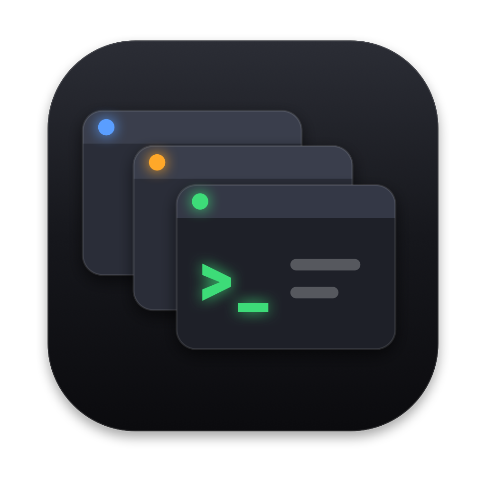

<p align="center"></p>

# AgentBoard

**Mission control for a team of AI coding agents on your Mac.**
AgentBoard is a native macOS app that shows what every Claude Code and Codex session is doing,
keeps them out of each other's way, lets you answer them from one place, and tells you at the end
of the day what got done — per project and per client.

---

## The problem

Running one coding agent is easy. Running four of them — two Claude Code terminals on one repo,
a Codex session on another, a fifth agent you started this morning and forgot about — is not:

- **You can't see what's happening.** Each agent lives in its own terminal tab. To know who is
  doing what, you tab through windows and scroll back through walls of tool output.
- **Agents don't know about each other.** Two of them edit the same file, one overwrites the
  other's work, or both "fix" the same bug in different ways. Nobody notices until the merge.
- **They wait on you silently.** A permission prompt, a question, a plan to approve — sitting in
  a background tab for twenty minutes while you think the agent is working.
- **Commits happen behind your back.** Something gets committed to the wrong branch, or with
  files another agent was still changing.
- **At the end of the day you can't say what was done.** Not for yourself, not for a client,
  not for a timesheet — the work is scattered across sessions that are already closed.
- **Agents go in circles.** The same failing command, ten times, burning time and limits.

AgentBoard sits next to your agents and turns all of that into one live board.

## What it does

### See everything, live
- **One card per terminal.** Every Claude Code or Codex session becomes an agent with its own
  superhero name (100 built in — Batman, Storm, Groot…), unique across all open sessions.
  The card shows status (working / waiting for you / idle / stuck / finished), project, branch,
  current task, the files it touches and its last action.
- **"What is it doing?" in plain words.** A small model (Claude Haiku via `claude -p`) writes one
  or two sentences per agent — *"Benchmarking Whisper on long and short clips to decide whether
  the Neural Engine build is worth switching to."* — refreshed only when the agent actually did
  something new.
- **Every action is recorded:** requests, shell commands, edits, reads, searches, subagents,
  MCP calls, failures, answers, commits. The feed shows the important events; one click shows all.
- **Subagents get their own lanes** (`↳ Explore: searching "login("`), with their description
  and result.
- **Real session status.** AgentBoard reads Claude Code's own session files and checks the
  process behind each one, so an idle-but-open terminal stays "idle" and a closed terminal is
  marked "finished" even if no goodbye event arrived.
- **History for any past day**, including sessions that ran *before* you installed AgentBoard:
  past Claude Code transcripts, Codex logs and git commits are imported when you add a project.

### Answer agents from one place
- **Permission requests, questions and plans** show up in *Needs your decision* — on the
  dashboard, in the menu bar and as macOS notifications with buttons. Allow, deny with a comment,
  "allow for this session", pick one of the agent's answer options or type your own, approve a
  plan or send it back. The terminal prompt stays open too; whichever you answer first wins.
- **Reply to an idle agent** right on its card, or from the notification. The text is delivered
  like a message typed into its terminal (Terminal.app, iTerm2, tmux); a busy agent gets it in
  its context at the next step; a closed session can be resumed in the background.
- **"While you were away".** Come back after a break and get a short digest: what was finished,
  what's waiting for you, who got stuck.

### Keep agents out of each other's way
- **Agents know their neighbours.** At session start and on every new request, each agent is told
  who else is working on the project and on what. Through the `agentboard` MCP server an agent can
  look at another agent's activity, message it, or post a note.
- **File reservations.** An agent reserves files, folders or globs before a risky edit
  (`reserve_files(["src/auth/"], minutes: 30, reason: "refactor login")`). Another agent trying
  to edit them is stopped with "talk to Batman first"; a commit by another agent that touches
  them is refused by a git pre-commit hook. Leases expire on their own, end with the session,
  and you can drop any of them from the app. Your own commits are never blocked.
- **Conflict warnings** when an agent edits a file someone else changed recently.
- **Stuck detection.** The same command failing three times, eight failures in a row, or the same
  action over and over → the agent is marked *stuck*, you get notified, and the agent itself is
  told to stop and change approach.
- **Commit control.** Log commits, get notified, or require your approval before an agent commits.

### Tasks, clients and time
- **The board fills itself.** Each work request you give an agent becomes a task on the kanban
  (Backlog / In progress / In review / Done) with a short title; a request about something new
  moves the previous task to review; a closed session sends its task to review. Tasks you or the
  agents manage explicitly are left alone.
- **Clients.** Every task and project can have a client; the summary and the time report group
  work by client.
- **Time per client and per task**, counted from the agents' real activity (idle gaps don't count):
  wall-clock time, where parallel agents count once, and total agent time.
- **Run a task in its own worktree.** "Start agent" on a task creates a branch and a git worktree,
  opens a terminal with Claude Code or Codex and hands it the task. Then review the branch in the
  app — a per-file diff with comments on lines that go straight back to the agent — and merge it,
  open a pull request, or remove the worktree.
- **Evening summary.** At a time you choose, a report in Markdown: highlights, what was done in
  code per project, per client (with time), what's unfinished, what needs attention. Saved in the
  app and to `~/Documents/AgentBoard/YYYY-MM-DD.md`.

### Make it yours
- Rename projects as you like (right-click in the sidebar) and remove the ones you don't work on —
  adding the same folder again brings back its tasks and history.
- 8 color schemes, custom accent, light/dark, density, card style, animations. Light on resources:
  ~0% CPU while idle.
- Dashboards built from widgets — stats, decisions, agents, feed, tasks, time, reservations,
  commits, clients, hot files, latest summary — that you drag around, resize and hide.

## Documentation

Full documentation lives in [docs/](docs/AGENTS.md): product, architecture and decisions, local API and MCP,
configuration, testing, security and the [changelog](docs/CHANGELOG.md).

## Installation

Requires macOS 14+ and the Command Line Tools (`xcode-select --install`). Xcode is not needed.

```sh
./scripts/build-app.sh --install   # build and copy to /Applications
```

Then, in the app:
1. **Integrations → Connect**: Claude Code hooks and MCP server; Codex hooks and MCP server if you use Codex
   (Codex asks once to trust the new hooks — accept).
2. **Add project**: pick a repository. Its git hooks are installed and its past sessions imported.
3. Restart Claude Code sessions that were already open.

If AgentBoard isn't running, the hooks do nothing and never get in the agents' way.
From the command line: `AgentBoard --install-claude`, `--install-codex`, `--uninstall-claude`.

## How it works

```
Claude Code ─hooks─▶ ~/.agentboard/bin/agentboard-hook ─HTTP─▶ AgentBoard.app (127.0.0.1:7777)
Codex       ─hooks─▶        (same bridge)                       │  SQLite, live UI
            ◀── context, decisions, messages ───────────────────┤
agents ─MCP (http://127.0.0.1:7777/mcp)─────────────────────────▶│
git ─pre-commit / post-commit─▶ agentboard-hook ────────────────▶│
~/.claude/sessions, ~/.claude/projects, ~/.codex/sessions ──read─▶│
```

| Hook | What AgentBoard does with it |
|---|---|
| SessionStart | registers the agent, gives it the team rules and the board |
| UserPromptSubmit | records the request, creates/updates the task, tells the agent what neighbours do, delivers messages |
| PreToolUse | records the action; enforces reservations; intercepts `git commit` |
| PermissionRequest | puts the permission / question / plan in *Needs your decision* |
| PostToolUse / PostToolUseFailure | delivers messages; detects loops |
| SubagentStart / SubagentStop | subagent lanes |
| Notification / Stop / SessionEnd | waiting for you, final answer, end of session |

MCP tools: `board`, `agent_activity`, `send_message`, `post_note`, `list_tasks`, `create_task`,
`claim_task`, `update_task`, `set_focus`, `reserve_files`, `release_files`, `who_touches`, `register_agent`.

## Privacy and safety

- Everything is stored locally: `~/Library/Application Support/AgentBoard` (SQLite). Detailed
  actions are kept 90 days; requests, answers, commits, notes and summaries are kept.
- The server listens on `127.0.0.1` only, refuses requests coming from web pages and requires a
  per-install token (`~/.agentboard/token`, owner-only) on every request — other users and apps on the
  Mac can't read the board or act as an agent. Messages between agents are handed over as information,
  never as the human's instructions.
- The plain-language status lines, task titles, "while you were away" and the evening summary are
  written by `claude -p` with your Claude Code login (no tools, no saved session) — so agent
  activity is sent to Anthropic, the same provider your agents already use. All of them can be
  turned off in Settings.
- Hook and settings changes are backed up (`*.agentboard-backup-*`) and only AgentBoard's own
  entries are ever touched.

## Development

```sh
./scripts/test.sh                                    # build + 317 checks (unit, contract, integration) on throwaway data
swift build && .build/debug/AgentBoard -port 7788    # debug instance on another port
AGENTBOARD_DATA_DIR=/tmp/ab AGENTBOARD_BRIDGE_DIR=/tmp/ab/bridge CLAUDE_CONFIG_DIR=/tmp/ab/claude \
  CODEX_HOME=/tmp/ab/codex .build/debug/AgentBoard -port 7788   # fully isolated
```

Native SwiftUI, Swift Package Manager, no dependencies beyond the system (SQLite, Network.framework).

## License

[MIT](LICENSE) © 2026 Mikhail Malashkin
