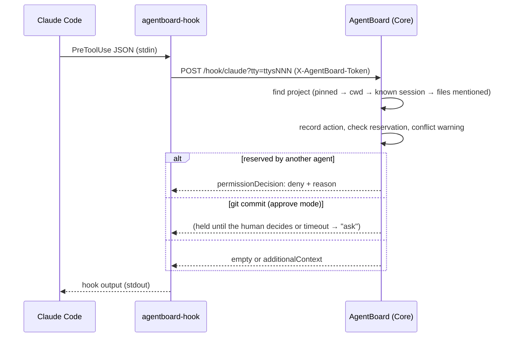
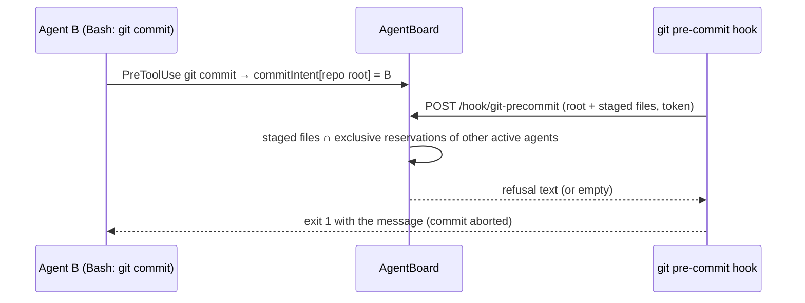

# Data flows

## A Claude Code tool call



## A permission request answered in the app

```mermaid
sequenceDiagram
  participant A as Claude Code / Codex
  participant S as AgentBoard
  participant H as Human
  A->>S: PermissionRequest (hook held open)
  S->>H: card in "Needs your decision" + notification with actions
  par terminal prompt stays live
    H-->>A: answers in terminal → PostToolUse arrives → request dropped in app
  and
    H->>S: Allow / Deny / answer / approve plan
    S-->>A: decision (Claude: updatedInput for answers; Codex: plain allow/deny)
  end
```

## Reservation enforced on commit



## From request to task, time and summary

1. `UserPromptSubmit` → `TaskAutopilot`: first work request → new *auto* task (title by Haiku);
   a request about something else → previous task to review, new task.
2. Every event stores the agent's current `task_id`.
3. `timeReport` groups an agent's events into working stretches (gaps ≤ 5 min), by task and client.
4. The evening summary gathers commits, tasks, prompts, answers, notes and the time report and asks `claude -p` for Markdown.
