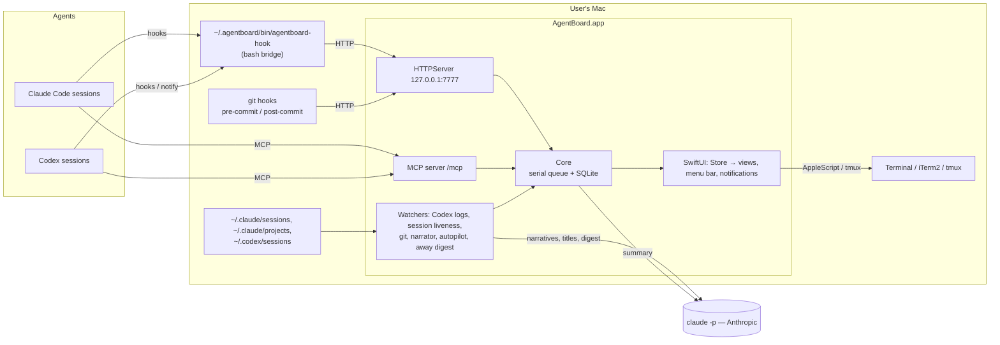

# Architecture overview

AgentBoard is a single macOS process. It owns a SQLite database, a small HTTP/1.1 server on
`127.0.0.1:7777`, background watchers, and the SwiftUI windows. Agents talk to it through a bash
bridge invoked by their hooks and through MCP; it talks back through hook responses.

## Components

| Component | Responsibility | Source |
|---|---|---|
| HTTPServer | Loopback HTTP/1.1, one request per connection, delayed replies | `HTTPServer.swift` |
| Core | DB, routing, hook handling, tasks, messages, commits | `Core.swift` |
| Coordination | Reservations, pre-commit guard, stuck detection, permission flow | `Coordination.swift` |
| MCP server | JSON-RPC tools for agents | `MCPServer.swift` |
| Watchers | Codex log follower, session liveness, git status, narrator, task autopilot, away digest | `CodexWatcher.swift`, `SessionLiveness.swift`, `GitMonitor.swift`, `Narrator.swift`, `AutoTasks.swift`, `AwayDigest.swift` |
| Integrations | Installs bridge, hooks, MCP registrations, git hooks | `Integrations.swift` |
| Delivery | Messages into sessions: inbox, terminal typing, background resume | `SessionDelivery.swift` |
| Workspaces | Task worktrees, terminal launch, diff, merge, PR | `Workspaces.swift` |
| UI | Store + SwiftUI views, notifications | `Store.swift`, `Views/`, `Notifier.swift` |

## Trust boundaries

- Agents and their hooks run as the user; their content is **untrusted text** (it may quote web pages).
- The HTTP server is reachable by any local process; browser requests are filtered by Origin/Host
  checks (see [security/overview.md](../security/overview.md) for known gaps).
- Model calls send activity text to Anthropic through the user's Claude Code login.
