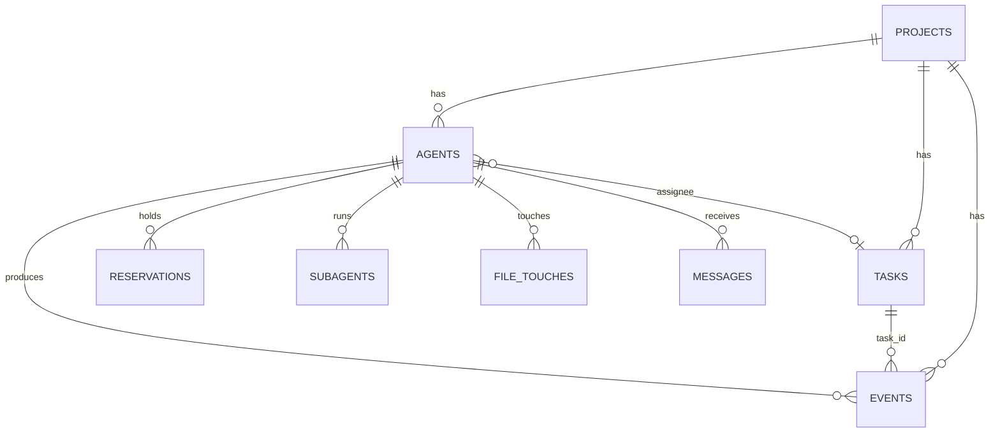

# Data model

SQLite at `~/Library/Application Support/AgentBoard/agentboard.sqlite`. Migrations are additive
(`CREATE TABLE IF NOT EXISTS`, `ADD COLUMN` when missing) and run at launch in `Core.migrate()`.

| Table | Key columns | Notes |
|---|---|---|
| `projects` | id, name, path, common_dir, client, aliases, archived_at | `aliases`: former paths (moved folders); `archived_at`: removed with *keep history* — hidden everywhere, restored (same id) when the same folder is added again |
| `agents` | id, project_id, tool, session_id, name, cwd, root, branch, status, last_prompt, focus, last_action, tty, stuck, narrative, pinned, started_at, last_seen, ended_at | status: working/waiting/idle/ended |
| `tasks` | id, project_id, title, details, client, status, assignee, created_by, worktree, branch, base_branch | created_by: `user`, agent id, or `auto` |
| `events` | id, project_id, agent_id, kind, title, detail, client, ref, created_at, sub, task_id | kinds below |
| `reservations` | project_id, agent_id, pattern, exclusive, reason, expires_at, released_at | patterns are repo-relative |
| `subagents` | id (Claude agent_id), agent_id, type, description, status, result | |
| `messages` | to_agent, from_agent, from_label, text, delivered_at | the agents' inbox |
| `file_touches` | agent_id, path, count, last_at | for conflict warnings and hot files |
| `summaries` | day, markdown, source | |
| `imported_sessions` | tool, session_id, project_id, last_at | history import bookkeeping |
| `codex_offsets` | path, offset | Codex log follower position |

**Event kinds:** `prompt`, `action`, `turn_done`, `commit`, `commit_request`, `commit_approved`,
`commit_denied`, `commit_timeout`, `push`, `conflict`, `waiting`, `note`, `message`, `focus`,
`task_created`, `task_status`, `task_claimed`, `session_start`, `session_end`, `tool_failed`, `stuck`,
`subagent`, `reservation`, `permission`, `workspace`, `narrative`.

**Retention** (`cleanupOldData`, at launch): detailed kinds (action, tool_failed, narrative, subagent,
reservation, session_*, focus, waiting, permission) older than 90 days; file touches > 30 days;
delivered messages > 30 days; expired reservations > 7 days; subagents > 30 days.
